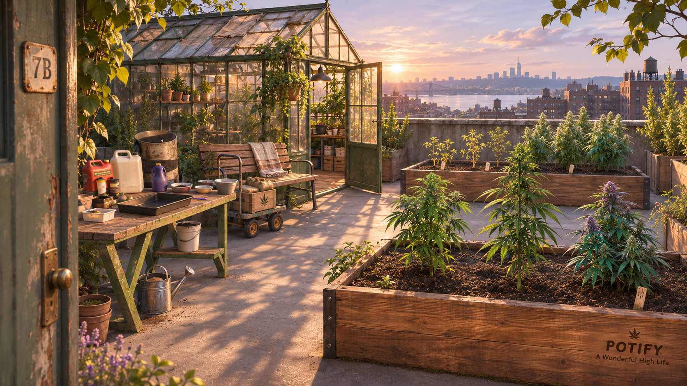
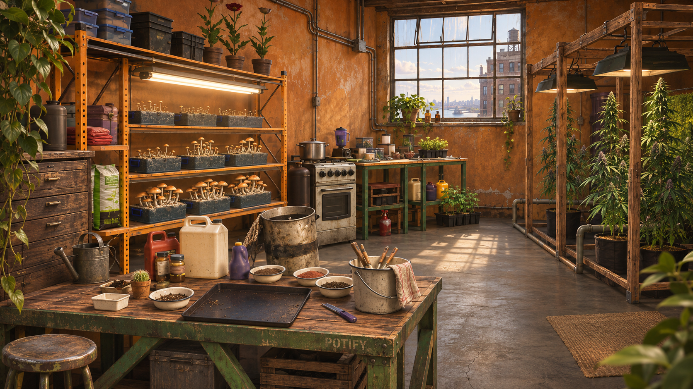
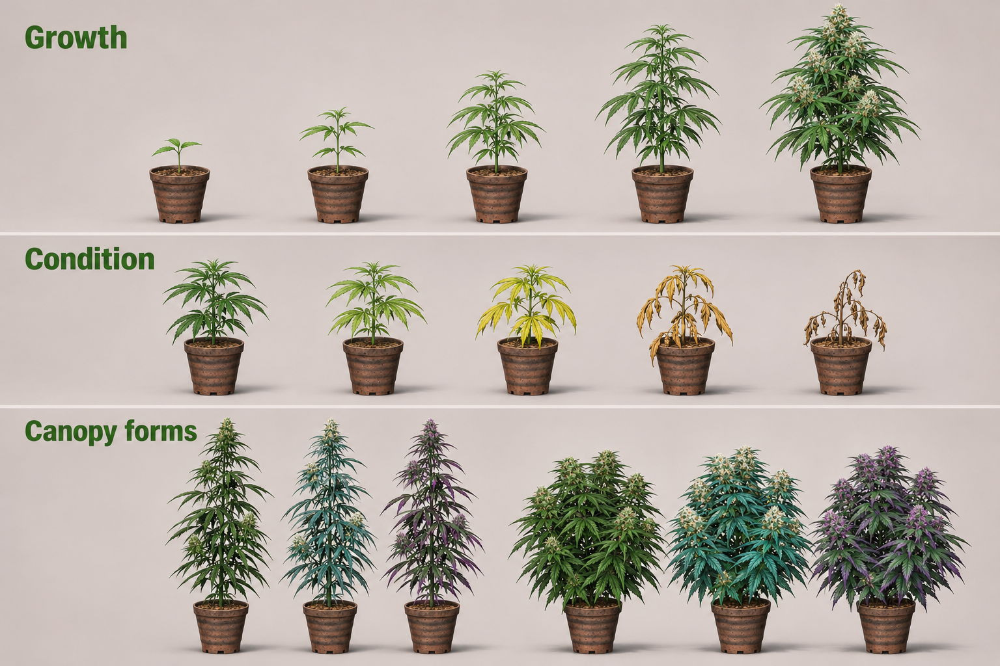
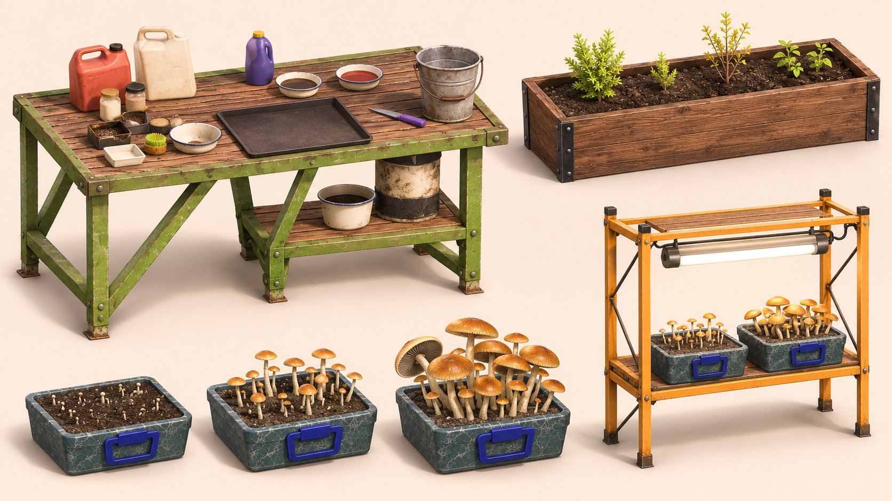

# Canopy House · Roof 7B

Concept art for the next 3D modeling pass on *POTIFY: A Wonderful High Life*. Nine grow-room, workbench, planter, mushroom and plant references informed these four original images. The rooftop carries forward the greenhouse, harvest cart and river skyline from the first-harvest campaign.

## The view from the stair door

The open greenhouse door draws the player across the roof. Keep a clear path between the workbench and the cedar beds. Frame enough river and neighboring rooftops to make the climb through Canopy House feel worthwhile.

## Inside the workroom

Follow the room from the lamp-lit mushroom shelf, past the enamel stove and potting bench, to the timber-framed plant bay. The high window looks out over the same river. Match the worn green steel and repaired wood across both spaces.

## Plant forms

Read the top row for age and the middle row for condition. Carry posture and branching into the models so players can recognize changes on a phone, even at a distance. The tall, open and compact, dense canopies each have green, blue-green and plum-accented variants.

## Workshop props

The bench, its loose tools and vessels, the raised bed, the lamp shelf and the removable trays are separate modeling subjects. Keep the same blue handles and tray shape through the three mushroom stages so the change in the crop is easy to see.
